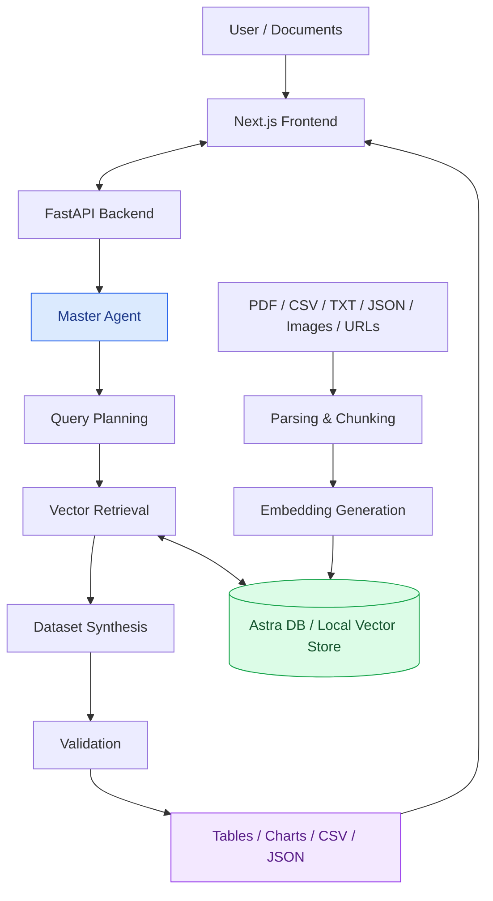

# RAGChat AI: Agentic Document Intelligence & Dataset Curation

---

## Overview

Enterprise repositories contain large volumes of unstructured and semi-structured documents, making it difficult to extract meaningful information and transform it into structured, analysis-ready datasets.

**RAGChat AI** is a multi-agent Retrieval-Augmented Generation (RAG) system that processes documents, retrieves relevant information, and generates structured datasets through natural language queries. It supports multiple file formats, vector-based retrieval, AI-powered synthesis, and data export.

## System Architecture



## Key Features

* **Multi-Agent Orchestration:** Coordinates specialized agents for conversation handling, query planning, information extraction, dataset synthesis, and validation.
* **Dynamic Dataset Generation:** Converts natural language queries into structured tables with automatically identified columns and downloadable CSV or JSON output.
* **Interactive Data Visualization:** Renders interactive bar charts and metric visualizations using D3.js.
* **Multi-Format Document Ingestion:** Supports PDF, TXT, CSV, JSON, images through OCR, and web URLs.
* **Flexible Vector Storage:** Integrates with DataStax Astra DB and supports a local vector store fallback.
* **Source Grounding and Execution Tracing:** Displays processing steps, similarity scores, and retrieved document excerpts to improve transparency.

## Configuration

RAGChat AI supports two methods for configuring API credentials.

### Method 1: Configure Through the Web Interface

1. Start the application and open `http://localhost:3000`.
2. Open **Settings** from the application header or select **Set API Key**.
3. Enter your Google Gemini API key, available from [Google AI Studio](https://aistudio.google.com/).
4. Select the desired Gemini model.
5. Optionally, configure your DataStax Astra DB token and endpoint.
6. Select **Test Connection**, then save the configuration.

The application uses the configured credentials for subsequent requests. Avoid entering API keys on untrusted deployments.

### Method 2: Configure Environment Variables

Create a `.env` file in the project root:

```bash
# Google Gemini Configuration
GEMINI_API_KEY=your_gemini_api_key_here
GEMINI_MODEL=gemini-1.5-flash

# DataStax Astra DB (Optional)
ASTRA_DB_API_TOKEN=your_astra_token_here
ASTRA_DB_ENDPOINT=https://your-database-id-region.apps.astra.datastax.com
ASTRA_DB_KEYSPACE=default_keyspace
COLLECTION_NAME=pdf

# Backend Server Configuration
HOST=0.0.0.0
PORT=8000
```

**Local Mode:** When cloud vector database credentials are not configured, the application can use its local vector storage implementation, provided the local mode dependencies are available. Document parsing, indexing, and retrieval capabilities depend on the configured embedding and storage implementations. Gemini-powered synthesis requires a valid API key.

Never commit `.env` files or expose API credentials in a public repository.

## Getting Started

### Prerequisites

* Python 3.10–3.13
* Node.js 18 or later
* npm

### 1. Set Up the Backend

Navigate to the project directory and create a virtual environment:

```bash
cd /path/to/ragchat

python3 -m venv .venv
source .venv/bin/activate
```

On Windows, activate the environment using:

```bash
.venv\Scripts\activate
```

Install the dependencies and start the FastAPI server:

```bash
pip install -r requirements.txt
python backend/main.py
```

The backend is available at `http://localhost:8000`.

### 2. Set Up the Frontend

Open a new terminal in the project directory:

```bash
npm install
npm run dev
```

Open `http://localhost:3000` in your browser.

### 3. Ingest Documents Through the CLI

Place the documents to be processed in `backend/structurisation/files/`.

Run the ingestion script with the virtual environment activated:

```bash
python backend/structurisation/main.py
```

## API Reference

| Method   | Endpoint         | Description                                   |
| -------- | ---------------- | --------------------------------------------- |
| `GET`    | `/`              | Check backend health and document statistics  |
| `POST`   | `/api/chat`      | Execute a chat query and multi-agent pipeline |
| `POST`   | `/api/upload`    | Upload supported documents                    |
| `POST`   | `/api/url`       | Ingest content from a web URL                 |
| `GET`    | `/api/documents` | List indexed documents and chunk counts       |
| `DELETE` | `/api/documents` | Clear indexed documents                       |
| `GET`    | `/api/config`    | Retrieve current configuration status         |
| `POST`   | `/api/config`    | Update API credentials and model settings     |

### Example Request

Submit a natural language query to the chat endpoint:

```json
{
  "query": "Extract the key entities and summarize the relevant information from the uploaded documents."
}
```

## Project Structure

```text
ragchat/
├── .env.example
├── .env
├── requirements.txt
├── package.json
├── setup.py
│
├── app/                         # Next.js frontend
│   ├── components/
│   │   └── BarChart.js          # D3.js visualization
│   ├── globals.css
│   ├── layout.js
│   └── page.js
│
└── backend/                     # FastAPI backend
    ├── main.py                  # API routes
    ├── config.py                # Application configuration
    │
    ├── agentify/                # Multi-agent subsystem
    │   ├── master_agent.py      # Agent orchestration
    │   ├── agents.py            # Specialized agents
    │   └── vector_db.py         # Vector storage and retrieval
    │
    └── structurisation/         # Document ingestion
        ├── file_processor.py    # Parsing and chunking
        ├── embedder.py          # Embedding and indexing
        ├── main.py              # CLI ingestion
        ├── files/               # Input documents
        └── output/              # Generated assets and cache
```

## Troubleshooting

**Gemini API Errors**

* Verify that the API key is valid and configured correctly.
* Check API availability, model access, and usage quotas in [Google AI Studio](https://aistudio.google.com/).

**Astra DB Connection Issues**

* Verify the database endpoint, token, and permissions.
* Confirm that the database is available and configured correctly.
* Use local vector storage if the application's fallback implementation supports the required operations.

**Port Conflicts**

* Change the backend port using the `PORT` environment variable.
* Update the frontend's backend URL configuration to match the new port.

---

## Technology Stack

* **Frontend:** Next.js, React, Tailwind CSS
* **Backend:** Python, FastAPI
* **AI and LLM:** Google Gemini
* **Retrieval:** Retrieval-Augmented Generation (RAG), vector embeddings
* **Vector Storage:** DataStax Astra DB, local vector store
* **Visualization:** D3.js
* **Document Processing:** PDF, CSV, JSON, TXT, OCR, web content
