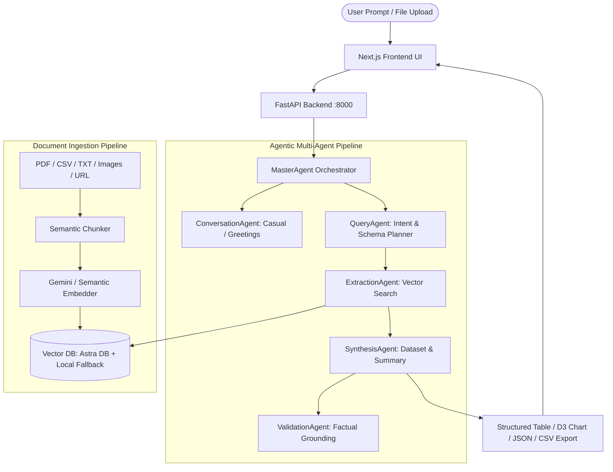

# RAGChat AI: Agentic Document Intelligence & Dataset Curation

---

## 🚀 Overview

Enterprises possess vast repositories of unstructured and semi-structured documents holding immense potential value, but transforming this raw information into structured, analysis-ready datasets remains a major bottleneck. 

**RAGChat AI** is an intelligent, multi-agent RAG (Retrieval-Augmented Generation) system that ingests document collections (PDF, TXT, CSV, JSON, images, and web URLs), chunks and embeds them into a vector database, and deploys specialized AI agents to dynamically retrieve, synthesize, and export analysis-ready structured datasets using natural language commands.

---

## 🔑 Where & How to Enter API Keys

You can enter your API keys using either of the two methods below:

### Method 1: Directly in the Web UI (Recommended & Instant)
1. Launch the web application (`http://localhost:3000`).
2. Click the **⚙️ Settings** icon in the top-right header (or the **"Set API Key"** badge).
3. In the Settings modal:
   - **Google Gemini API Key**: Paste your key (get one free at [aistudio.google.com](https://aistudio.google.com/)).
   - **Gemini Model**: Choose your preferred model (e.g., `gemini-1.5-flash`, `gemini-2.0-flash`, `gemini-1.5-pro`).
   - *(Optional)* **DataStax Astra DB Token & Endpoint**: If using cloud vector search from [astra.datastax.com](https://astra.datastax.com/).
4. Click **"Test Connection"** to verify, then click **"Save Settings"**.
5. Your keys are securely preserved in your browser session and automatically transmitted with your requests.

---

### Method 2: In the `.env` Configuration File
Create or edit the `.env` file in the project root directory:

```bash
# 1. Google Gemini API Key (Get a free key from https://aistudio.google.com/)
GEMINI_API_KEY=your_gemini_api_key_here

# Model to use (default: gemini-1.5-flash)
GEMINI_MODEL=gemini-1.5-flash

# 2. DataStax Astra DB (Optional - In-Memory/Local Vector Store is used automatically if empty)
ASTRA_DB_API_TOKEN=your_astra_token_here
ASTRA_DB_ENDPOINT=https://your-database-id-region.apps.astra.datastax.com
ASTRA_DB_KEYSPACE=default_keyspace
COLLECTION_NAME=pdf

# 3. Server Configuration
HOST=0.0.0.0
PORT=8000
```

> **Note on Offline / Local Mode:**  
> If you haven't added an API key yet, the application still works! It uses a high-performance local vector database, pure-Python PDF extraction, and deterministic semantic vectors so you can test document indexing, chunking, and search right away. Once you supply your Gemini API key, full multi-agent LLM synthesis and reasoning activate automatically.

---

## 🏛️ System Architecture



---

## 📋 Features

- **Multi-Agent Orchestration**: Specialized agents for conversation, query planning, vector extraction, dataset synthesis, and factual verification.
- **Dynamic Dataset Generation**: Translates natural language queries into structured tables with auto-detected columns, downloadable as CSV or JSON.
- **D3 Data Visualization**: Dynamic interactive Bar and Metric charts rendered on synthesized dataset records.
- **Multi-Format Ingestion**: Ingests PDFs (pure-Python `pypdf`, no system binaries needed), CSV, JSON, TXT, images (OCR), and live web URLs.
- **Dual-Mode Vector Database**: Connects to DataStax Astra DB when configured, with seamless, zero-config local vector store persistence when offline.
- **Step Trace & Source Grounding**: Every response shows pipeline execution steps, similarity scores, and retrieved document snippets.

---

## ⚡ Quickstart Guide

### 1. Prerequisites
- **Python**: 3.10 to 3.13
- **Node.js**: v18.0 or newer

### 2. Backend Setup

```bash
# 1. Navigate to the project root
cd /path/to/ragchat

# 2. Create and activate a Python virtual environment
python3 -m venv .venv
source .venv/bin/activate    # On Windows: .venv\Scripts\activate

# 3. Install Python dependencies
pip install -r requirements.txt

# 4. Start the FastAPI backend server
python backend/main.py
```
*The backend API will be running at `http://localhost:8000`.*

---

### 3. Frontend Setup

In a new terminal window:

```bash
# 1. Install Node.js dependencies
npm install

# 2. Run the Next.js development server
npm run dev
```
*Open your browser and navigate to `http://localhost:3000`.*

---

### 4. Direct Document Ingestion (CLI)

To ingest all documents currently placed inside `backend/structurisation/files/`:

```bash
# With virtual environment activated:
python backend/structurisation/main.py
```

---

## 📡 API Endpoints Reference

| Method | Endpoint | Description |
|---|---|---|
| `GET` | `/` | Health check and loaded document statistics |
| `POST` | `/api/chat` | Chat & multi-agent query execution (`{"query": "..."}`) |
| `POST` | `/api/upload` | Multipart file upload (PDF, TXT, CSV, JSON, PNG, JPG) |
| `POST` | `/api/url` | Ingest web content from URL (`{"url": "https://..."}`) |
| `GET` | `/api/documents` | List all indexed documents and chunk counts |
| `DELETE` | `/api/documents` | Clear all documents from vector store |
| `GET` | `/api/config` | Read current API configuration and readiness |
| `POST` | `/api/config` | Update API keys and models dynamically |

---

## 📁 Project Structure

```
ragchat/
├── .env.example                # Template for environment variables
├── .env                        # Active configuration (Gemini & Astra keys)
├── requirements.txt            # Clean Python dependencies
├── package.json                # Next.js & React frontend dependencies
├── setup.py                    # Project setup package metadata
│
├── app/                        # Next.js Frontend (React 19, Tailwind v4)
│   ├── components/
│   │   └── BarChart.js         # Interactive D3 Bar Chart component
│   ├── globals.css             # Dark theme styling tokens & scrollbars
│   ├── layout.js               # Root layout & typography
│   └── page.js                 # Chat UI, Settings modal, Dataset viewer
│
└── backend/                    # Python Backend (FastAPI)
    ├── main.py                 # Primary FastAPI application & API routes
    ├── config.py               # Centralized configuration & header overrides
    │
    ├── agentify/               # Multi-Agent Subsystem
    │   ├── master_agent.py     # MasterAgent orchestrator & step tracer
    │   ├── agents.py           # Specialized agents (Query, Extraction, etc.)
    │   └── vector_db.py        # Dual-mode Astra DB & local vector store
    │
    └── structurisation/        # Document Ingestion Pipeline
        ├── file_processor.py   # Multi-format parsing & text chunker
        ├── embedder.py         # Embedding generator & VectorDB loader
        ├── main.py             # CLI batch ingestion runner
        ├── files/              # Input directory for documents (e.g. docs1.pdf)
        └── output/             # Local vector store cache & extracted assets
```

---

## 🛠️ Troubleshooting

- **Gemini API Key Issues:** Ensure your key starts with `AIzaSy...`. Check your usage quota at [Google AI Studio](https://aistudio.google.com/).
- **Astra DB Connection:** If Astra DB is unreachable or credentials have expired, RAGChat automatically operates in local vector store mode with zero downtime.
- **Port Conflict (8000 or 3000):** If port 8000 is occupied, you can change `PORT=8001` in `.env` and update the Backend URL inside the web UI Settings.

---

## 👥 Contributors
- **Arshith Vaz**
- **Maxon Fernandes**
- **Janice Dsouza**
- **Kaavya Rao**
